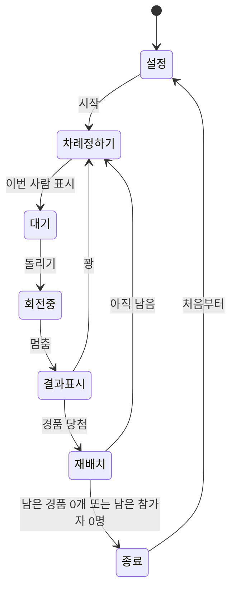

# 럭키드로우 원판 추첨 사이트 요구사항

버전 0.1 · 작성일 2026-10-17

## 목차

1. 한 줄 요약
2. 용어
3. 진행 흐름
4. 예시로 따라가기 (모든 중간 상태)
5. 기능 요구사항
6. 화면 구성
7. 원판 동작 규칙
8. 예외 상황
9. 비기능 요구사항
10. AI 티 안 나게 만들기 (anti AI slop)
11. 완료 기준 (테스트 체크리스트)
12. 아직 정하지 않은 것

---

## 1. 한 줄 요약

참가자와 경품을 입력하면 "경품 칸 + 꽝 1칸"으로 된 원판이 만들어진다. 한 사람씩 원판을 돌리고, 경품에 걸리면 그 사람은 경품을 받고 명단에서 빠지며, 걸린 경품 칸도 원판에서 빠진 뒤 남은 칸이 다시 섞인다.

---

## 2. 용어

| 용어 | 뜻 |
|---|---|
| 참가자 | 추첨에 참여하는 사람. 이름 또는 번호(1번, 2번…) |
| 경품 | 나눠줄 물건. 이름과 수량을 가짐 |
| 칸 | 원판의 한 조각. 경품 1개 = 칸 1개, 꽝은 항상 1칸 |
| 차례 | 지금 원판을 돌릴 사람 |
| 바퀴 | 남은 참가자가 모두 한 번씩 돌리는 것 |
| 재배치 | 경품 칸이 하나 빠진 뒤, 남은 칸 순서를 무작위로 다시 섞고 크기를 다시 나누는 것 |
| 당첨자 명단 | 경품을 받은 사람과 받은 경품 목록 |

---

## 3. 진행 흐름



글로 풀면:

1. **설정**: 참가자, 경품을 입력한다.
2. **차례 정하기**: 이번 바퀴 순서표에서 다음 사람을 꺼낸다.
3. **대기**: "이번 차례: 김민수"가 크게 보인다. 돌리기 버튼이 켜진다.
4. **회전 중**: 원판이 돈다. 모든 버튼이 잠긴다.
5. **결과 표시**: 멈춘 칸을 보여준다.
   - 경품이면 → 당첨자 명단에 추가, 그 사람은 참가자에서 빠짐, 그 경품 칸 1개 제거 → **재배치**
   - 꽝이면 → 그 사람은 명단에 남음, 원판은 그대로 → 다음 차례
6. **종료**: 경품이 다 나갔거나 남은 사람이 없으면 끝. 결과 화면을 보여준다.

---

## 4. 예시로 따라가기 (모든 중간 상태)

**입력**
- 참가자 4명: A, B, C, D
- 경품: 커피 쿠폰 2개, 이어폰 1개

### 시작 상태

| 항목 | 값 |
|---|---|
| 남은 참가자 | A, B, C, D |
| 원판 칸 (4칸, 각 90°) | 커피, 이어폰, 꽝, 커피 |
| 1바퀴 순서표 (섞음) | A → C → B → D |
| 꽝 확률 | 1/4 = 25% |

### 1번째: A 차례 → 커피 당첨

| 항목 | 바뀌기 전 | 바뀐 후 |
|---|---|---|
| 남은 참가자 | A, B, C, D | B, C, D |
| 원판 칸 | 커피, 이어폰, 꽝, 커피 | (커피 1칸 제거 후 섞음) 이어폰, 커피, 꽝 — 각 120° |
| 당첨자 명단 | 없음 | A: 커피 |
| 꽝 확률 | 25% | 1/3 ≈ 33% |

### 2번째: C 차례 → 꽝

| 항목 | 바뀌기 전 | 바뀐 후 |
|---|---|---|
| 남은 참가자 | B, C, D | B, C, D (C는 남음) |
| 원판 칸 | 이어폰, 커피, 꽝 | 그대로 (꽝은 재배치 안 함) |
| 당첨자 명단 | A: 커피 | 변화 없음 |

### 3번째: B 차례 → 이어폰 당첨

| 항목 | 바뀌기 전 | 바뀐 후 |
|---|---|---|
| 남은 참가자 | B, C, D | C, D |
| 원판 칸 | 이어폰, 커피, 꽝 | (이어폰 제거 후 섞음) 꽝, 커피 — 각 180° |
| 당첨자 명단 | A: 커피 | A: 커피, B: 이어폰 |
| 꽝 확률 | 33% | 1/2 = 50% |

### 4번째: D 차례 → 커피 당첨

| 항목 | 바뀌기 전 | 바뀐 후 |
|---|---|---|
| 남은 참가자 | C, D | C |
| 원판 칸 | 꽝, 커피 | 꽝만 남음 |
| 당첨자 명단 | A, B | A: 커피, B: 이어폰, D: 커피 |

### 종료

남은 경품이 0개라서 끝난다. C는 받은 경품 없이 끝.

> 알아둘 점: 꽝은 항상 1칸이라서, 경품이 줄어들수록 꽝에 걸릴 확률이 올라간다. (경품 k개 남으면 꽝 확률 = 1/(k+1))

---

## 5. 기능 요구사항

우선순위: **P0** 꼭 있어야 함 / **P1** 있으면 좋음 / **P2** 나중에

### 5.1 참가자 입력

| ID | 내용 | 우선순위 |
|---|---|---|
| F-01 | 입력 방식 두 가지 중 선택: **이름 목록** 또는 **인원수(숫자)** | P0 |
| F-02 | 이름 목록은 줄바꿈 또는 쉼표로 구분. 앞뒤 공백 제거, 빈 줄 무시 | P0 |
| F-03 | 숫자 입력 시 "1번"~"N번" 참가자를 자동 생성 (1 ≤ N ≤ 500) | P0 |
| F-04 | 같은 이름이 있으면 "김민수(2)"처럼 번호를 붙이고 입력칸 아래에 알려줌 | P0 |
| F-05 | 입력 중 현재 인원수를 실시간 표시 ("12명") | P1 |

### 5.2 경품 입력

| ID | 내용 | 우선순위 |
|---|---|---|
| F-10 | 경품마다 이름과 수량(기본 1) 입력. 줄 추가/삭제 가능 | P0 |
| F-11 | 경품 1개가 원판 1칸. 커피 쿠폰 3개면 칸 3개 | P0 |
| F-12 | 꽝 칸은 항상 정확히 1개 자동 추가. 사용자가 지우거나 늘릴 수 없음 | P0 |
| F-13 | 전체 칸 수(경품 합계 + 1)는 최대 30칸. 넘으면 시작 버튼을 막고 이유를 표시 | P0 |
| F-14 | 붙여넣기 지원: "커피 쿠폰 x3" 형식의 여러 줄을 한 번에 입력 | P2 |

### 5.3 차례 정하기

| ID | 내용 | 우선순위 |
|---|---|---|
| F-20 | 바퀴가 시작될 때 남은 참가자를 무작위로 섞어 순서표를 만든다 | P0 |
| F-21 | 한 바퀴 안에서 같은 사람이 두 번 돌리지 않는다 | P0 |
| F-22 | 순서표가 비면 남은 참가자로 새 바퀴를 만든다 | P0 |
| F-23 | 진행자가 명단에서 사람을 직접 눌러 이번 차례를 바꿀 수 있다 | P1 |
| F-24 | 화면 옆에 "다음 순서" 3명을 미리 보여준다 | P1 |

### 5.4 돌리기와 결과

| ID | 내용 | 우선순위 |
|---|---|---|
| F-30 | 돌리기 버튼, 스페이스바, 원판 클릭 중 하나로 회전 시작 | P0 |
| F-31 | 결과는 회전 시작 **전에** 무작위로 정하고, 원판은 그 칸에 멈추도록 애니메이션한다 (7장 참고) | P0 |
| F-32 | 회전 중에는 돌리기·입력·명단 수정이 모두 잠긴다 | P0 |
| F-33 | 경품 당첨 시: 당첨자 명단에 (이름, 경품, 순번, 시각) 추가 → 참가자에서 제거 → 해당 경품 칸 1개 제거 → 재배치 | P0 |
| F-34 | 꽝일 때: 참가자는 남고, 원판은 그대로 | P0 |
| F-35 | 결과는 화면 가운데에 크게 1.5초 이상 보여준 뒤 "다음 사람" 버튼으로 넘어간다 (자동으로 넘어가지 않음) | P0 |
| F-36 | 방금 한 번의 결과만 되돌리기 ("방금 결과 취소"). 진행 실수 대비용 | P1 |

### 5.5 재배치

| ID | 내용 | 우선순위 |
|---|---|---|
| F-40 | 남은 칸(경품 + 꽝)의 순서를 무작위로 섞는다 | P0 |
| F-41 | 모든 칸은 같은 크기: 360° ÷ 남은 칸 수 | P0 |
| F-42 | 섞인 결과가 직전 배치와 완전히 같으면 다시 섞는다 (칸이 3개 이상일 때) | P1 |
| F-43 | 재배치는 0.6초 안팎의 짧은 전환으로 보여준다. 사라지는 칸이 어디였는지 알 수 있어야 함 | P1 |

### 5.6 종료와 결과

| ID | 내용 | 우선순위 |
|---|---|---|
| F-50 | 남은 경품 0개 또는 남은 참가자 0명이면 종료 | P0 |
| F-51 | 종료 화면: 당첨자 명단 표, 경품을 못 받은 참가자 목록, 남은 경품 목록 | P0 |
| F-52 | 당첨자 명단 CSV 다운로드 | P1 |
| F-53 | 당첨자 명단 클립보드 복사 (탭 구분, 엑셀에 바로 붙여넣기 가능) | P1 |
| F-54 | "처음부터" 버튼: 확인 대화상자 후 초기화. "같은 명단으로 다시"도 선택 가능 | P1 |

### 5.7 저장

| ID | 내용 | 우선순위 |
|---|---|---|
| F-60 | 진행 상태를 브라우저(localStorage)에 저장. 새로고침해도 이어서 진행 | P0 |
| F-61 | 저장된 진행이 있으면 첫 화면에서 "이어서 하기 / 새로 시작" 선택 | P0 |
| F-62 | localStorage를 쓸 수 없는 환경에서도 사이트는 정상 동작 (저장만 안 됨) | P0 |

---

## 6. 화면 구성

화면은 3개: **설정 → 추첨 → 결과**

### 6.1 설정 화면

```
┌───────────────────────────────────────────────┐
│ 럭키드로우                                     │
├──────────────────────┬────────────────────────┤
│ 참가자               │ 경품                    │
│ (•) 이름  ( ) 인원수  │ 커피 쿠폰      [ 2 ] [x] │
│ ┌──────────────────┐ │ 이어폰         [ 1 ] [x] │
│ │ 김민수           │ │ [+ 경품 추가]            │
│ │ 이서연           │ │                          │
│ │ ...              │ │ 원판: 경품 3칸 + 꽝 1칸   │
│ └──────────────────┘ │                          │
│ 4명                  │                          │
├──────────────────────┴────────────────────────┤
│                                   [ 추첨 시작 ] │
└───────────────────────────────────────────────┘
```

### 6.2 추첨 화면

```
┌───────────────────────────────────────────────┐
│ 남은 경품 3 · 남은 사람 4            [설정][끝] │
├────────────────────────────┬──────────────────┤
│              ▼             │ 이번 차례         │
│          ╭───────╮         │  김민수           │
│        ╱  커피    ╲        │                  │
│       │ 꽝 │ 이어폰 │       │ 다음: 이서연,     │
│        ╲  커피    ╱        │      박지훈       │
│          ╰───────╯         │                  │
│        [  돌리기  ]         │ 당첨자            │
│                            │ 1. 최유나  커피   │
└────────────────────────────┴──────────────────┘
```

- 원판이 주인공. 화면 높이의 70% 이상 차지 (프로젝터 기준)
- 바늘(▼)은 원판 위쪽 가운데 고정
- 휴대폰(가로 360px)에서는 원판 → 이번 차례 → 당첨자 순으로 세로 배치

### 6.3 결과 화면

- 당첨자 명단 표 (순번, 이름, 경품)
- 경품을 못 받은 사람, 남은 경품
- CSV 다운로드, 복사, 처음부터

---

## 7. 원판 동작 규칙

| 항목 | 규칙 |
|---|---|
| 결과 정하기 | `crypto.getRandomValues`로 남은 칸 중 하나를 균등하게 고른다 (`Math.random` 사용 안 함) |
| 멈출 각도 | 고른 칸 안에서 가장자리 10%를 뺀 범위의 임의 위치. 칸 경계선에 걸쳐 보이는 일이 없도록 |
| 회전량 | 5~8바퀴 + 목표 각도 |
| 회전 시간 | 4~6초, 끝으로 갈수록 느려짐 (ease-out) |
| 바늘 | 위쪽 고정. 원판만 돈다 |
| 칸 글자 | 칸 중심선을 따라 바깥쪽에서 안쪽으로. 칸이 20개를 넘으면 글자 크기를 줄이고, 그래도 넘치면 말줄임 + 마우스 올리면 전체 이름 |
| 꽝 칸 | 경품 칸과 확실히 구분되는 색과 무늬 (색만으로 구분하지 않음) |
| 동작 줄이기 설정 | 운영체제에서 "동작 줄이기"가 켜져 있으면 회전을 0.5초로 줄이거나 바로 결과 표시 |

---

## 8. 예외 상황

| 상황 | 동작 |
|---|---|
| 참가자 0명 | 시작 버튼 비활성, "참가자를 1명 이상 입력하세요" |
| 경품 0개 | 시작 버튼 비활성, "경품을 1개 이상 입력하세요" |
| 경품 수량 0 이하 또는 숫자 아님 | 그 줄을 빨간 테두리로 표시, 시작 막음 |
| 칸이 30개 초과 | "원판은 최대 30칸입니다. 지금 34칸" 표시, 시작 막음 |
| 경품이 사람보다 많음 | 시작은 허용. "경품 2개는 남게 됩니다" 안내 |
| 원판에 꽝만 남음 | 바로 종료 |
| 남은 참가자 1명, 경품 남음 | 계속 진행. 그 사람이 꽝이면 다음 바퀴도 그 사람 |
| 회전 중 새로고침 | 회전 시작 전에 결과를 저장해 두고, 다시 열면 그 결과를 바로 반영 |
| 같은 이름 | 자동 번호 붙임 (F-04) |

> 남은 사람이 1명이고 계속 꽝이 나오면 끝나지 않을 수 있다. 진행자가 "끝" 버튼으로 언제든 종료할 수 있어야 한다. (P0)

---

## 9. 비기능 요구사항

| 항목 | 요구 |
|---|---|
| 구성 | 서버 없이 정적 파일(HTML/CSS/JS)만으로 동작. 로그인 없음 |
| 인터넷 | 처음 연 뒤에는 인터넷이 끊겨도 추첨 가능 (폰트 실패 시 시스템 글꼴로 대체) |
| 원판 그리기 | SVG 권장 (글자가 선명하고 크기 조절이 쉬움) |
| 화면 크기 | 1920×1080 프로젝터, 1366×768 노트북, 360px 폭 휴대폰 |
| 성능 | 회전 애니메이션 60fps 유지 (중간급 노트북 기준) |
| 키보드 | 스페이스: 돌리기, Enter: 다음 사람, Esc: 결과 닫기. 포커스 위치가 항상 보임 |
| 접근성 | 결과를 `aria-live`로 읽어줌. 글자 대비 4.5:1 이상 |
| 언어 | 한국어 |
| 개인정보 | 입력한 이름은 브라우저 밖으로 나가지 않음. 분석 도구·외부 전송 없음 |

---

## 10. AI 티 안 나게 만들기 (anti AI slop)

목표: "AI가 대충 만든 템플릿"처럼 보이지 않고, 실제 행사장에서 쓰는 추첨판처럼 보이게 한다.

### 10.1 디자인 방향

**주제: 체육대회·사내 행사의 손으로 만든 경품 추첨판.** 두꺼운 판에 굵은 글씨로 칸을 나눈 느낌.

| 역할 | 색 | 값 |
|---|---|---|
| 바탕 | 연한 회청색 | `#E9EDF1` |
| 글자·테두리 | 먹색 | `#1A1A1A` |
| 경품 칸 A | 노랑 | `#F2C230` |
| 경품 칸 B | 청록 | `#0F7A78` |
| 꽝 칸 | 회색 + 사선 무늬 | `#8C8C8C` |
| 강조 (당첨 표시) | 빨강 | `#D7263D` |

- 글꼴 제안: 원판 글자·당첨자 이름은 굵은 한글 제목체(예: Black Han Sans), 나머지는 본문용 한글 고딕 한 가지
- 기억에 남는 요소는 **원판 하나**. 나머지 화면은 조용하게
- 원판 테두리는 두껍고 단단하게. 바늘은 실물처럼 무게감 있게

### 10.2 하지 말 것 → 대신 할 것 (화면)

| 하지 말 것 | 대신 |
|---|---|
| 보라·파랑 그라데이션 배경 | 단색 바탕 (10.1 색표) |
| 모든 내용을 둥근 카드 + 같은 그림자로 감싸기 | 영역 구분은 여백과 선 하나로 |
| 유리 효과(반투명 + 블러) | 쓰지 않음 |
| 제목 위 작은 영문 대문자 라벨 ("LUCKY DRAW") | 라벨 없이 바로 제목 |
| 제목에서 한 단어만 다른 색으로 강조 | 제목은 한 가지 색 |
| 버튼 글자 끝에 "→" | 동작만 쓰기: "돌리기" |
| 화면 진입할 때마다 위로 스르륵 나타나는 효과 | 움직임은 회전·재배치·결과 표시 세 군데만 |
| 당첨 때 꽃가루 + 반짝이 + 흔들림을 한꺼번에 | 효과는 하나만, 1.5초 이내 |
| 아무 의미 없는 01 / 02 / 03 번호 | 순서가 진짜 있는 곳(당첨 순번)에만 번호 |
| 아이콘 남발 | 아이콘은 삭제(x), 추가(+) 정도만 |

### 10.3 하지 말 것 → 대신 할 것 (문구)

| 하지 말 것 | 대신 |
|---|---|
| 이모지 (🎉✨🎁) | 쓰지 않음 |
| "행운의 주인공은 과연 누구일까요?" | "이번 차례: 김민수" |
| "축하드립니다! 놀라운 경품에 당첨되셨어요!" | "김민수 님 당첨: 커피 쿠폰" |
| "아쉽지만 다음 기회에… 😢" | "꽝" |
| "추첨 시작하기", "Submit" | "추첨 시작" / "돌리기" / "다음 사람" |
| "앗! 문제가 발생했어요" | "경품 수량은 1 이상이어야 합니다" (무엇이 왜 잘못됐는지) |
| 영어·한국어 섞인 버튼 | 한국어로 통일 |

같은 동작은 끝까지 같은 이름을 쓴다. 버튼이 "돌리기"면 상태 표시도 "돌리는 중".

### 10.4 하지 말 것 (코드)

- "여기서 마법이 일어납니다" 같은 장식 주석. 주석은 이유가 필요한 곳에만
- 쓰지 않는 함수, 남은 `console.log`, lorem ipsum 자리채움 글
- 의미 없는 래퍼 `div` 겹겹이, `.container-wrapper-inner` 같은 이름
- 서로 덮어쓰는 CSS 규칙 (`!important`로 해결하지 않기)
- 아무 데나 붙인 라이브러리. 원판·애니메이션은 직접 구현 가능한 크기

### 10.5 검수 방법

완성 후 아래를 확인한다.

1. 스크린샷을 보고 "이거 아무 AI 사이트랑 똑같다"는 느낌이 나는 요소 하나를 골라 지운다
2. 화면의 모든 문구를 소리 내 읽었을 때 진행자가 실제로 할 말과 비슷한가
3. 10.2 ~ 10.4 표의 왼쪽 항목이 하나도 없는가
4. 이모지 검색: 코드 전체에서 이모지 0개

---

## 11. 완료 기준 (테스트 체크리스트)

| # | 시나리오 | 기대 결과 |
|---|---|---|
| T-01 | 4장 예시 그대로 입력 | 원판 4칸(커피 2, 이어폰 1, 꽝 1) |
| T-02 | 경품 당첨 | 당첨자가 참가자 명단에서 사라지고, 칸이 1개 줄고, 순서가 다시 섞임 |
| T-03 | 꽝 | 참가자 수·칸 수 변화 없음 |
| T-04 | 당첨자가 다시 차례가 되는지 | 절대 안 됨 |
| T-05 | 같은 바퀴에서 같은 사람 두 번 | 안 됨 |
| T-06 | 경품 모두 소진 | 자동 종료, 결과 화면 |
| T-07 | 사람 모두 소진 | 자동 종료, 남은 경품 표시 |
| T-08 | 회전 중 버튼·입력 | 모두 잠김 |
| T-09 | 바늘이 가리키는 칸 = 화면에 표시된 결과 | 1,000번 자동 테스트에서 100% 일치 |
| T-10 | 공정성 | 4칸 원판 10,000번 자동 테스트에서 각 칸 22~28% |
| T-11 | 진행 중 새로고침 | 같은 상태로 이어짐 |
| T-12 | 숫자 30 입력 | "1번"~"30번" 생성 |
| T-13 | 같은 이름 2개 | "이름", "이름(2)"로 구분 |
| T-14 | 31칸 입력 | 시작 막힘, 안내 문구 표시 |
| T-15 | 휴대폰 360px | 가로 스크롤 없음, 원판 전체 보임 |
| T-16 | 키보드만으로 처음부터 끝까지 | 가능 |
| T-17 | 동작 줄이기 켜짐 | 회전 0.5초 이하 |
| T-18 | CSV 다운로드 | 엑셀에서 한글 안 깨짐 (UTF-8 BOM) |
| T-19 | 10장 검수 | 10.5의 4개 항목 통과 |

---

## 12. 아직 정하지 않은 것

기본값으로 먼저 만들고, 바꾸고 싶으면 알려주세요.

| 질문 | 지금 기본값 | 다른 선택지 |
|---|---|---|
| 꽝 나온 사람은? | 명단에 남아 다음 바퀴에 다시 돌림 | 꽝도 바로 탈락 |
| 차례 순서는? | 바퀴마다 무작위 | 입력한 순서대로 |
| 경품 수량 3개면? | 칸 3개 (많을수록 잘 나옴) | 칸 1개, 당첨될 때마다 수량만 줄어듦 |
| 원판 최대 칸 수 | 30칸 | 제한 없이 글자 대신 번호 + 범례 |
| 꽝 칸 크기 | 경품 칸과 같음 | 꽝 비율을 직접 지정 |
| 경품 이미지 | 없음 | 경품 사진 업로드 |
